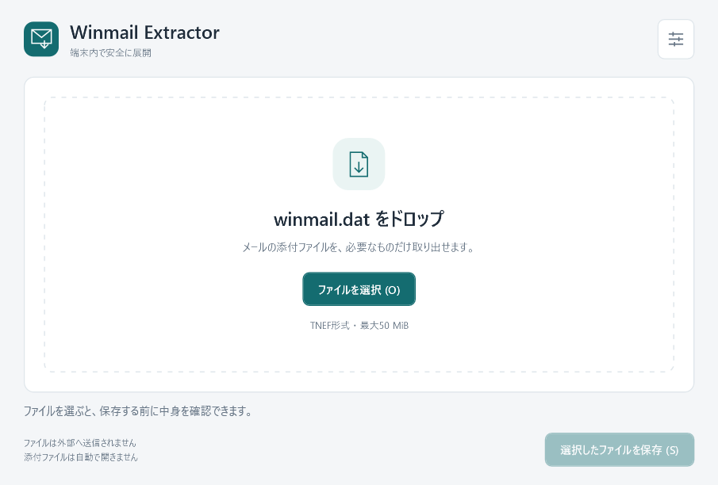
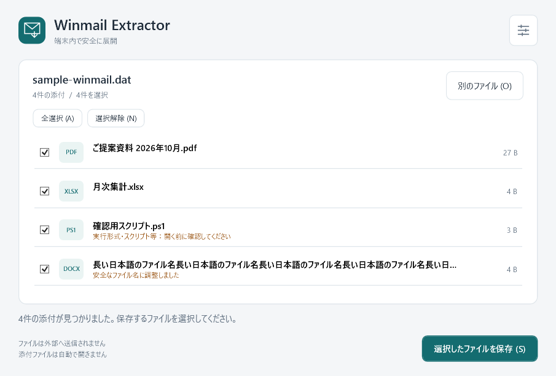

# Winmail Extractor

`winmail.dat`（TNEF本体）から添付を取り出す、日本語のポータブルWPFアプリです。Windows x64 / .NET 10。配布用EXEにランタイムを同梱します。

**メールの添付を、端末内で、必要なものだけ。** インストーラー不要のEXEを1つ置くだけで使えます。

**[初回プレビュー版をダウンロード](https://github.com/PrismEnsembleStudio/WinmailExtractor/releases/tag/v1.0.0-preview.1)** · [Release一覧](https://github.com/PrismEnsembleStudio/WinmailExtractor/releases) · [検証結果](docs/VALIDATION.md)

**[EXEを直接ダウンロード（ビルド不要）](https://github.com/PrismEnsembleStudio/WinmailExtractor/raw/refs/heads/main/dist/win-x64/WinmailExtractor.exe)** — リポジトリ内の `dist/win-x64` にも配布EXEとSHA-256を置いています。

> 初回公開はプレビュー版です。Windows 10 x64でビルド・自動テスト46件・EXE単体の起動を確認しています。Windows 11実機での右クリック連携、対話操作、実際のDPI変更は確認が残っています。不具合報告・改善提案を歓迎します。



## できること

- 保存前に添付を一覧表示し、必要なファイルだけ選択して保存
- 読み込み・展開サイズの制限、不正な名前の補正、既存ファイルの上書き防止
- 現在のユーザーだけの右クリック連携を、設定から登録・解除
- ネットワークへのアップロード、メールアカウントへの接続、自動実行はなし



画面例は合成TNEFからの描画です。実際のメールや個人情報は使用していません。

## 起動と使い方

1. 上の「EXEを直接ダウンロード」、または [GitHub Releases](https://github.com/PrismEnsembleStudio/WinmailExtractor/releases) の **Assets** から `WinmailExtractor.exe` をダウンロードします。
2. 任意のローカルフォルダーに置き、起動します。.NETランタイムの別途インストールは不要です。
3. ファイルを画面へドロップ、または「ファイルを選択」（Ctrl+O）で指定します。EXEへのドロップ・ファイルパス付き起動にも対応します。
4. 一覧のチェックで保存対象を選び、「選択したファイルを保存」でフォルダーを指定します。解析だけでは保存されません。
5. 保存完了後の「保存先を開く」でフォルダーを開けます。添付そのものは自動で開きません。

ソースから発行した場合の出力先は `artifacts/release/win-x64/WinmailExtractor.exe` です。EXEは未署名です。入手元とSHA-256を確認して利用してください。

Alt+O / Alt+A / Alt+N / Alt+S / Alt+F のアクセスキー、Tab・Spaceでの操作に対応します。長い名前は省略表示し、ツールチップで名前を確認できます。

## 右クリックメニュー

右上の設定を開き「登録 / 再登録」を押すと、**現在のWindowsユーザーのみ**の `.dat` メニューに「Winmail Extractorで開く」が追加されます。管理者権限は不要です。初回起動だけで登録することはありません。

Windows 11では「その他のオプションを確認」側を使用してください。`.dat` の既定アプリは変更しません。

- EXEは置き場所を決めてから登録してください。移動した場合は、新しい場所のEXEを起動して再登録します。
- 削除する前に設定の「解除」を押してください。移動前の登録も、所有マーカーを確認して自分の項目だけ解除できます。
- 空白・日本語・`&`・括弧を含むEXEパスを引用符付きで扱います。Shellの引数置換との混同を避けるため、`%` を含むEXEパスからの登録は拒否し、移動を案内します。
- 同名キーにこのアプリの所有マーカーがない場合は、登録・解除とも行いません。

登録先は次の**専用キーのみ**です。

```text
HKEY_CURRENT_USER\Software\Classes\SystemFileAssociations\.dat\shell\WinmailExtractor
  (Default) = Winmail Extractorで開く
  Owner = WinmailExtractor.Portable.v1
  ExecutablePath = C:\配置場所\WinmailExtractor.exe
  Icon = "C:\配置場所\WinmailExtractor.exe",0
  MultiSelectModel = Single
  command\(Default) = "C:\配置場所\WinmailExtractor.exe" "%1"
```

設定での解除ができないときの復旧方法は [手動確認手順](docs/MANUAL-TESTS.md) に記載しています。

## 安全性・取り扱い範囲

- アプリに通信・アップロード・メール接続・更新確認・テレメトリー機能はありません。内容やパスを外部送信するコードも、添付内容を記録するログもありません。ネットワーク共有を自分で保存先等に指定した場合は通常のWindowsファイルアクセスが発生するため、端末内で完結させる場合はローカルフォルダーを選んでください。
- 入力は読み取り専用で開き、変更・削除しません。解析用の作業ファイルも作りません。メモリ上で解析します。
- 入力50 MiB、添付256件、1件50 MiB、読み取る添付データ合計100 MiBまで。属性8192、添付ごとのプロパティ8192、プロパティ値256、名前データ64 KiBにも制限があります。上限は `ExtractionLimits` で調整できます。通常の添付データを解凍する処理はなく、保持量は入力と添付の上限で制限されます。
- MimeKitLite 4.18.1 の `TnefReader` をStrictモードで使用します。署名・レコード長・チェックサム・プロパティ長を検査します。`TnefPart.ExtractAttachments()` は本文RTFまで展開する実装のため、採用していません。メール本文、圧縮RTF、HTMLは表示・展開しません。
- 通常のByValue添付、旧形式のAttachData、MAPIのAttachData、Unicode名・CP932名・名前なし・ゼロバイト添付に対応します。埋め込みメール、OLE、参照形式、Object型データ等は候補から除外し、理由を表示します。`.eml` 全体を直接読み込む機能はありません。
- 内部のパスをファイル名へ平坦化し、不正文字・制御文字・表示方向制御文字・Windows予約名・末尾のドットや空白を処理します。長い名前は拡張子を残して最大160 UTF-16文字に短縮します。
- 保存は直下への `CreateNew` で行い、同名なら `name (2).ext` のように採番します。既存ファイルを上書きしません。保存先の祖先も含め、リンク・ジャンクションを拒否し、処理中のフォルダーの差し替えをハンドルで防ぎます。
- 実行形式・スクリプト・ショートカット・マクロ付きOffice等は注意表示します。注意表示のない拡張子でも安全性を保証しません。添付の自動実行・自動プレビューはありません。
- 保存中のエラーは保存済み件数と併せて表示します。複数ファイルの一括保存はトランザクションではなく、先に保存できたファイルは残ります。再保存した場合も上書きせず別名になります。

## 開発・再現

必要なものはWindows x64、.NET SDK **10.0.301**、初回復元時のNuGet接続です。`global.json` で検証済みSDKに固定しています。アプリの実行にSDK・NuGet接続は不要です。SDKや依存のバージョンを更新するときは、通常用・発行用の両ロックを更新して再検証してください。

```powershell
dotnet restore WinmailExtractor.sln --locked-mode
dotnet build WinmailExtractor.sln -c Release --no-restore -m:1
dotnet test tests\WinmailExtractor.Tests -c Release --no-build --no-restore
.\publish.ps1
```

`publish.ps1` は復元、Releaseビルド、自動テスト、win-x64 self-contained / single-file publish、出力がEXE1個であることの検査、SHA-256表示まで行います。既存ファイルを消さず、出力先が空でない場合は停止します。再発行するときは、新しい出力先を指定してください。

通常ビルドは `packages.lock.json`、ランタイム同梱発行は `packages.publish.lock.json` を使います。発行時にSDKツール依存が変わるため、両方のロックをソースに含めています。デバッグ情報も各アセンブリへ埋め込み、外部PDBを配布物へ残しません。

```powershell
.\publish.ps1 -OutputDirectory .\artifacts\release-next\win-x64
```

発行処理の主コマンド：

```powershell
dotnet publish src\WinmailExtractor -c Release -r win-x64 --self-contained true `
  -p:RuntimeFrameworkVersion=10.0.13 -p:PublishSingleFile=true -p:EnableCompressionInSingleFile=true -p:PublishTrimmed=false `
  -p:IncludeNativeLibrariesForSelfExtract=true -p:IncludeAllContentForSelfExtract=true `
  -p:NuGetLockFilePath=packages.publish.lock.json -p:RestoreLockedMode=true `
  -o artifacts\release\win-x64 -m:1
```

WPFをTrimしていません。単一EXEには.NETとWPFも入るため、通常の小さいユーティリティより容量が大きくなります。WPF・ネイティブDLL等は実行時に.NETが `%TEMP%\.net\WinmailExtractor\...` に展開・キャッシュします。これはアプリの解析作業ファイルではありません。EXEの近くにDLL等を配置する必要はありません。未署名のためWindows/SmartScreenの警告が出る場合があります。警告・署名検証を無効にする設定変更は不要です。

WPF描画・ビューモデルの検証（本番メニューの登録は行いません）：

```powershell
dotnet build tools\WinmailExtractor.Verify -c Release -m:1
dotnet tools\WinmailExtractor.Verify\bin\Release\net10.0-windows\WinmailExtractor.Verify.dll artifacts\verification
```

合成TNEF、エラー用DAT、WPF描画PNGが `artifacts/verification` に生成されます。PDF/Officeという名前の合成添付はバイト検証用であり、実際のOffice文書としての表示テスト用ではありません。

配布EXEのみを別フォルダーへコピーして起動確認する場合：

```powershell
dotnet tools\WinmailExtractor.Verify\bin\Release\net10.0-windows\WinmailExtractor.Verify.dll artifacts\verification-final
.\tools\Test-Portable.ps1
```

このスモーク試験は自分で起動したプロセスだけを終了します。レジストリを登録せず、通信を行わず、無引数・正常TNEF引数・不正DAT・不存在ファイル・複数引数で起動が維持されることを調べます。ランタイム未導入の実機試験を代替しません。

## 主なファイル

|場所|役割|
|---|---|
|`src/WinmailExtractor`|日本語WPF画面、設定、ViewModel、自作アイコン・スタイル|
|`src/WinmailExtractor.Core`|TNEF解析、ファイル名対策、安全な保存、ユーザー単位のShell登録|
|`tests/WinmailExtractor.Tests`|合成TNEFと自動テスト。レジストリ試験は一時専用キーに隔離|
|`tools/WinmailExtractor.Verify`|コンパイル済みWPFの描画と読み込み・選択・保存・エラー状態の検証|
|`publish.ps1`|配布用EXEの再現可能な発行|
|`docs/VALIDATION.md`|今回の確認結果と未確認事項|
|`docs/MANUAL-TESTS.md`|Windows 11の実機確認・解除・復旧手順|

## 依存関係・ライセンス・参照

このプロジェクトのソースコードは [MIT License](LICENSE) で公開します。第三者ソフトウェアにはそれぞれのライセンスが適用されます。

MimeKitLiteはMimeKit公式の暗号機能を省いた版です。TNEFの公開APIは共通です。4.18.1は破損TNEFの整数オーバーフロー対策を含みます。テーマライブラリを追加せず、ベクターアイコンはこのプロジェクトで作成しています。

- [MimeKitLite 4.18.1 / MIT](https://www.nuget.org/packages/MimeKitLite/4.18.1)
- [.NET / WPFと同梱コンポーネントの通知](docs/THIRD-PARTY-NOTICES.txt)。この通知全文はEXEにも埋め込み、設定画面から閲覧できます。
- [TnefReader公開API](https://mimekit.net/docs/html/T_MimeKit_Tnef_TnefReader.htm)、[TnefPart公開ソース](https://github.com/jstedfast/MimeKit/blob/4.18.1/MimeKit/Tnef/TnefPart.cs)
- [Microsoft：ユーザー単位のファイル型登録](https://learn.microsoft.com/en-us/windows/win32/shell/fa-file-types)、[SystemFileAssociationsの検索規則](https://learn.microsoft.com/en-us/windows/win32/shell/fa-associationarray)、[Shellコマンドの引用符](https://learn.microsoft.com/en-us/windows/win32/shell/context)
- [Microsoft：単一ファイル配布と一時展開](https://learn.microsoft.com/en-us/dotnet/core/deploying/single-file/overview)

テスト用パッケージ（xUnit、Microsoft.NET.Test.Sdk、coverlet等）は配布EXEに含めません。実際の業務メールをソースやテストへ取り込んでいません。

## 不具合報告・改善提案

[Issues](https://github.com/PrismEnsembleStudio/WinmailExtractor/issues) へ、バージョン、Windowsの版、再現手順、期待する動作をお知らせください。**実際のメール・添付内容・個人情報・秘密情報は投稿しないでください。** 可能なら合成データで再現方法を共有してください。開発への参加については [CONTRIBUTING.md](CONTRIBUTING.md) を参照してください。
